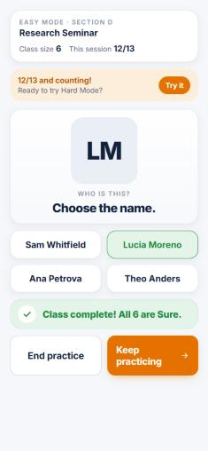
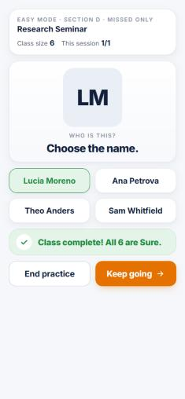
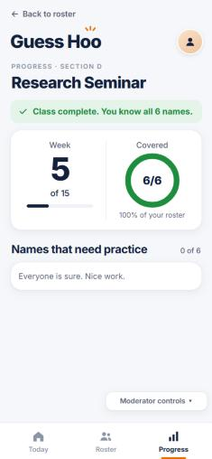
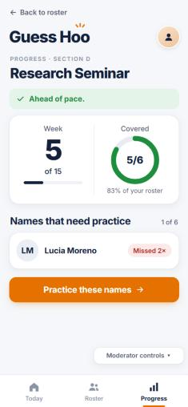
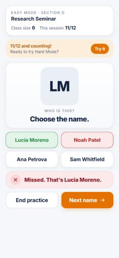

# PR #1: Show when a class is complete

| | |
|---|---|
| Pull request | [aidanporges-blip/NameParker#1](https://github.com/aidanporges-blip/NameParker/pull/1) |
| Branch | `class-complete-moment` into `main` |
| Author | aidanporges-blip |
| Reviewer | ATRAUL |
| Opened | 2026-11-07 |
| Files changed | `app.js` |

This is a copy of the pull request description, kept in the repo with its screenshots so it stays with the code.

## Story

As Pascal the Professor, I want a clear sign when I know every name in a class, so that I know I'm done and don't keep looking for a finish button.

Before this change, nothing happened when the last student became Sure: practice just kept asking names, and Progress kept showing a pace message. The product brief calls this its main open question ("Is 100% coverage a sufficient ending?"), and usability prompt 5 asks participants "How would you know you are done?"

## Scenarios

**1. Finishing the class during practice**
- Given Pascal is practicing Section D and 5 of its 6 students are Sure
- When he gets the last student right for the second time
- Then the app tells him all 6 names are Sure and the class is complete
- And he can end practice or keep practicing

**2. Seeing a finished class on Progress**
- Given every student in Section D is Sure
- When Pascal looks at Section D's progress
- Then he sees that the class is complete, instead of a pace message
- And no names are listed as needing practice

**3. Slipping back after finishing (goes wrong)**
- Given Section D is complete
- When Pascal misses one of its students
- Then Section D is no longer shown as complete
- And that student is listed as needing practice

**4. Not done yet (goes wrong)**
- Given 5 of Section D's 6 students are Sure
- When Pascal misses the last student
- Then no completion message appears
- And that student comes back within the next two questions

Scenarios 3 and 4 guard the brief's "no false claims of full coverage" rule.

## What changed

When an answer makes every student in the class Sure, the practice feedback now says "Class complete! All 6 are Sure." and the Next button becomes "Keep going", so Pascal can stop or carry on. The Progress screen shows "Class complete. You know all 6 names." in place of the pace message whenever the class is at 100%, and goes back to the pace message as soon as anyone slips. Only `app.js` changed; nothing new is saved, and the story 4 re-ask behavior is untouched.

## What the AI got wrong, and how I caught it

The AI labeled the button after the completion message "Keep practicing". In the app's side-by-side button row that label is too long for a half-width button at phone size (375 px wide): it wrapped onto two lines ("Keep / practicing") and pushed the arrow out of line. Nothing in the code looked wrong, and the AI did not check the length when writing it. It was caught while running Scenario 1 by hand at phone width and looking at the screen right after the class completed. Fix: the label was shortened to "Keep going", and Scenario 1 was run again; the button now fits on one line. (This was a code fix, not a scenario change.)

Before the fix ("Keep practicing" wraps onto two lines):



## Scenario results

All four were run by clicking through the app at phone size (375 × 812), starting from Moderator controls → Reset all progress, then playing Section D until 5 of 6 students were Sure (Lucia Moreno the last one still Shaky).

| # | Result | What I did | What I expected | What happened |
|---|---|---|---|---|
| 1 | **Fail, then pass after a code fix** | With 5 of 6 Sure, answered Lucia Moreno correctly | "Class complete" message, with options to end or keep going | First run: message showed, but the "Keep practicing" button wrapped onto two lines. After renaming it "Keep going" and re-running: "Class complete! All 6 are Sure." with End practice and Keep going on one line. Tapping Keep going moved on normally. |
| 2 | **Pass** | Reloaded the page, opened Section D → View progress | "Class complete" instead of a pace message; empty needs-practice list | "Class complete. You know all 6 names.", ring 6/6, "Names that need practice 0 of 6: Everyone is sure. Nice work." Still there after a page reload. |
| 3 | **Pass** | In the complete class, started practice and picked the wrong name for Lucia, then opened Progress | No longer complete; Lucia listed as needing practice | Banner went back to "Ahead of pace.", ring 5/6, Lucia Moreno listed under "Names that need practice" (Missed 2×). |
| 4 | **Pass** | With 5 of 6 Sure, picked the wrong name for Lucia | No completion message; Lucia back within two questions | Feedback said "Missed. That's Lucia Moreno." with no completion message, and Lucia was the very next question. |

| 1. Class complete (after fix) | 2. Progress: complete | 3. Slipped back | 4. Missed the last student |
|---|---|---|---|
|  |  |  |  |

Also checked: a right answer in a class that is already complete does not show the message again; the story 4 check (missed names return within two questions) still passes 500/500; Hard Mode with a timer still fits on one phone screen when the class completes (696 of 812 px).

## How to check it

1. Get the branch and open the app:
   ```bash
   git fetch origin
   git switch class-complete-moment
   ```
   Then open `index.html` in Chrome or Edge (double-click it). For phone size, press F12 and turn on the device toolbar (375 × 812).
2. Open **Moderator controls → Reset all progress**.
3. Open **Research Seminar (Section D) → Practice these names → Start practice** (Easy Mode, Untimed). Answer by matching the initials to the name. Keep going until the Roster shows 5 Sure and 1 Shaky (about 11 right answers).
4. **Scenario 4:** when the Shaky student comes up, pick a wrong name. You should see "Missed. That's …" and no completion message; the same student should come straight back.
5. **Scenario 1:** answer that student correctly. You should see "Class complete! All 6 are Sure." with **End practice** and **Keep going** on one line each.
6. **Scenario 2:** tap End practice → View progress (reload the page first if you like). You should see "Class complete. You know all 6 names.", 6/6, and "Everyone is sure. Nice work."
7. **Scenario 3:** go back, start practice again, and pick a wrong name. End practice → View progress. The complete banner should be gone (a pace message instead), 5/6, and that student listed under "Names that need practice".
