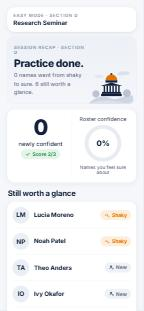
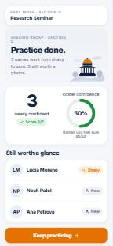
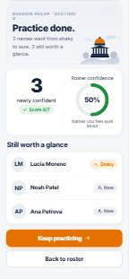
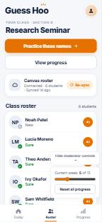
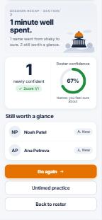
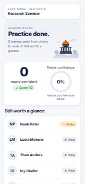

## Story

As Pascal the Professor, I want a quick readback when I end an untimed practice, so that I can see my score and which names are still shaky before I walk into class.

Before this change, the session recap only appeared when a timed round's clock ran out. If Pascal practiced untimed and tapped End practice, he was dropped back on the roster with no summary of how it went. This is backlog story 6 ("Section-specific readback") in `Product Brief/stories.md`.

## Scenarios

**1. Ending an untimed practice**
- Given Pascal is practicing Section D untimed and has answered several names, missing one
- When he ends practice
- Then he sees a readback for Section D with his score for this session
- And he sees which names are still not Sure
- And he can go back to the roster from the readback

**2. A name he has missed (goes wrong)**
- Given Pascal has missed Lucia Moreno and has not gotten her right since
- When he ends practice
- Then Lucia is listed under "Still worth a glance", ahead of names he has never missed

_(Reworded after review: the list is ordered by misses across all sessions, the same as Progress, not just this round. See "Changes after review".)_

**3. Ending before answering anything (goes wrong)**
- Given Pascal starts untimed practice and answers no names
- When he ends practice
- Then no readback appears (there is nothing to report, so no "Score 0/0")
- And he goes straight back to the roster

**4. Timed rounds still work**
- Given Pascal is in a 1-minute timed round
- When the timer runs out
- Then he still sees the timed recap ("1 minute well spent.")
- And he can go back to the roster from it

## What changed

Tapping End practice in an untimed round with at least one answer now shows the session recap: "Practice done.", the section, the score, how many names became Sure, and the names still worth a glance. The recap has Keep going and Back to roster buttons (timed recaps keep Go again and Untimed practice, plus Back to roster). Ending with no answers, or ending a timed round early, behaves as before. Only `app.js` changed; nothing new is saved.

## What the AI got wrong, and how I caught it

The AI wired End practice to "show the recap" but left the old End practice button rendered underneath the recap, and added a new Back to roster button above it. On the untimed readback, that leftover End practice button did nothing when tapped: the new handler saw an untimed round with answers and "ended" it again, so the screen stayed exactly the same. Nothing in the code looked wrong at a glance. It was caught while running Scenario 1 by hand: after the readback appeared, I tapped End practice expecting to leave and stayed stuck on the recap (the page text still read "Practice done." after the tap). The AI's plan also assumed the timed recap had no way out, when in fact that same End practice button was its exit. Fix (code, not scenario): End practice is hidden once the recap is showing, since Back to roster replaces it, and End practice now always leaves if the round has already ended. Scenarios 1 to 3 were run again after the fix.

Before the fix (End practice under the recap did nothing):



## Scenario results

All four were run by clicking through the app at phone size (375 × 812) in Section D, starting from Moderator controls → Reset all progress.

| # | Result | What I did | What I expected | What happened |
|---|---|---|---|---|
| 1 | **Fail, then pass after a code fix** | Untimed practice, answered 7 names (missed Lucia once), tapped End practice | Readback with section, score, names still not Sure, and a way back to the roster | First run: readback showed, but the leftover End practice button under it did nothing. After the fix: "Session recap · Section D", "Practice done.", Score 6/7, 3 newly confident, 3 still worth a glance, buttons Keep practicing and Back to roster only. Back to roster opened the Section D roster. |
| 2 | **Pass** | Same run: Lucia was missed and not answered again | Lucia listed first under "Still worth a glance" | Lucia Moreno (Shaky) first, then Noah Patel and Ana Petrova (New). |
| 3 | **Pass** | Started untimed practice, tapped End practice without answering | No readback; straight to the roster | Landed on the Section D roster, no recap. Run before and after the fix. |
| 4 | **Pass** | Started a 1-minute round, answered one name, let the timer run out | Timed recap as before, with a way back | "1 minute well spent.", Score 1/1, 1 newly confident; buttons Go again, Untimed practice, Back to roster. Back to roster opened the roster. |

| 1 & 2. Untimed readback | 1. Readback buttons | 3. No answers | 4. Timed recap |
|---|---|---|---|
|  |  |  |  |

Also checked: no errors in the browser console. Not re-checked: ending a timed round early (that path was not changed and still goes to the roster). The screenshots above were taken before review, so they still show the old "Section D" label and "Keep practicing"; see below for the current version.

## Changes after review

Aidan approved with two suggestions and a nit. All three were taken:

1. **Section label wrapped at phone width (code fix).** "SESSION RECAP · SECTION D" broke onto two lines next to the illustration, and the session card above already shows "Section D · Research Seminar". The recap label is back to plain "Session recap".
2. **Scenario 2 said "this round", but the list sorts by all-time misses (scenario fix).** The "Still worth a glance" list is ordered by misses from every session, the same rule Progress uses. Rather than change the code and make the recap disagree with Progress, Scenario 2 was reworded to "A name he has missed". The code is unchanged for this one.
3. **Button wording (code fix).** The untimed recap's "Keep practicing" is now "Keep going", matching the class-complete message from PR #1.

Re-checked at 375 × 812 after the changes: untimed practice in Section D, one right and one miss (Noah Patel), then End practice. "SESSION RECAP" fits on one line, Noah (missed) is listed first, and the only buttons are Keep going and Back to roster.



## How to check it

1. Get the branch and open the app:
   ```bash
   git fetch origin
   git switch untimed-readback
   ```
   Then open `index.html` in Chrome or Edge. For phone size, press F12 and turn on the device toolbar (375 × 812).
2. Open **Moderator controls → Reset all progress**.
3. **Scenario 3:** open **Research Seminar (Section D) → Practice these names**, leave the timer on **Untimed**, tap **Start practice**, then tap **End practice** right away. You should land on the roster with no recap.
4. **Scenarios 1 and 2:** start untimed practice again. Answer a few names correctly, and when Lucia Moreno (LM) comes up, pick a wrong name. Tap **End practice** before she comes back. You should see "Session recap" (on one line), "Practice done.", your score, and Lucia first under "Still worth a glance". There should be only two buttons: **Keep going** and **Back to roster**. Tap **Back to roster**.
5. **Scenario 4:** choose the **1 min** timer, start practice, answer one name, and wait for the timer. You should see "1 minute well spent." with **Go again**, **Untimed practice**, and **Back to roster**.
