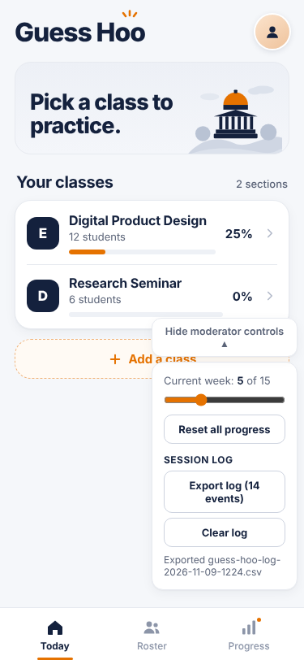
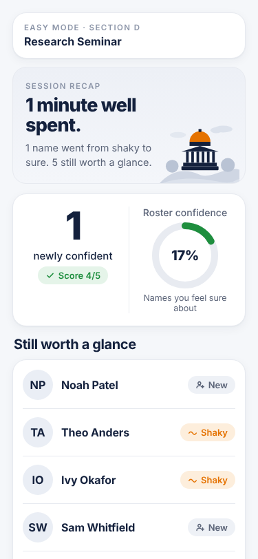
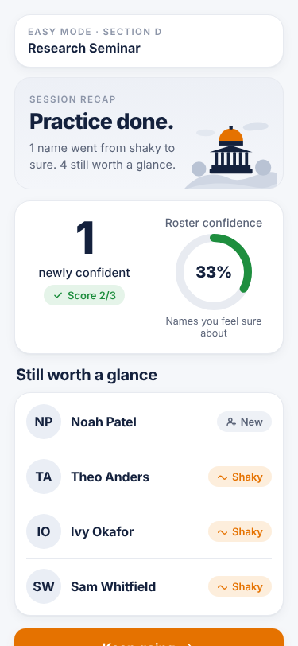
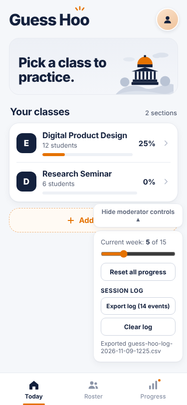
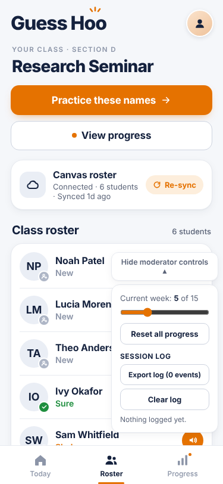

## Story

As a moderator running usability sessions, I want every answer and round recorded with timestamps and exported after each session, so that I can measure what participants actually did instead of relying on notes.

Before this change, the only record of a usability session was whatever the moderator wrote down. Nothing the participant did (which names they got wrong, how long they took, how a round ended) could be measured afterward.

**Preview (no git needed):** https://raw.githack.com/aidanporges-blip/NameParker/answer-log/index.html

## Scenarios

**1. A timed round is fully recorded**
- Given a participant picks Research Seminar (Section D) and plays a 1-minute round
- When the timer runs out and the moderator exports the log
- Then the file has a round start (section, mode, 1 min, all names), the time to the first face, one row per answer (student, right or wrong, new status, response time), and a round end with reason "timer"

**2. Ending early (goes wrong)**
- Given a participant stops an untimed round partway through
- When the moderator exports the log
- Then the round end says "ended early", with the score the participant actually reached

**3. Resetting progress doesn't lose the log (goes wrong)**
- Given a session has been played and logged
- When the moderator resets all progress to set up the next participant
- Then the export still includes every event from the earlier session

**4. The browser blocks storage (goes wrong)**
- Given the browser won't let the app save anything (for example, a locked-down private window)
- When the participant practices and the moderator tries to export
- Then practice still works normally, and Export says "Nothing logged yet." instead of crashing

## What changed

The app now keeps a separate, timestamped log of each round start, time to first face, every answer, and each round end. The Moderator controls panel has an **Export log (N events)** button that downloads it as a CSV (`guess-hoo-log-YYYY-MM-DD-HHMM.csv`), and a **Clear log** button that asks "Export first?" if anything is unexported. The log has its own storage slot, separate from progress, so Reset all progress leaves it alone. Files changed: `storage.js` (log functions), `app.js` (one log call at each point, plus the two buttons), and `style.css` (panel styling).

## What the AI got wrong, and how I caught it

The AI put the new **Export log (14 events)** button in the Moderator controls panel using the same style as Reset all progress. That panel is only 180px wide on a phone, so the label broke onto two lines ("Export log (14" / "events)"). Nothing in the code looked wrong. I caught it while running Scenario 3 at phone size (375 × 812): the screenshot of the panel after reset showed the wrapped label. Fix (code, not scenario): the log button now uses slightly smaller text and tighter padding, so it fits on one line. All four scenarios were run again after the fix.

The AI also left out one round-end reason from the original plan, "left from the recap". Every recap already comes after a round end has been logged (by the timer or End practice), so logging another end when leaving the recap would have counted the same round twice. Each round now gets exactly one round end.

Before the fix (label wraps):

## Scenario results

All four were run at phone size (375 × 812) in Section D, starting from Moderator controls → Reset all progress. Each export was opened and its rows checked.

| # | Result | What I did | What I expected | What happened |
|---|---|---|---|---|
| 1 | **Pass** | Tapped Research Seminar, chose 1 min, answered 5 names (first one wrong), let the timer run out, exported | Round start, first face, 5 answer rows, round end "timer" | CSV had 8 rows for round 1: round_start (D, easy, 1 min, all), first_face, 5 answers (Ivy Okafor wrong → learning, then right → confident), round_end "timer", score 4/5, 60 seconds. |
| 2 | **Pass** | Untimed practice, answered 3 names (one wrong), tapped End practice | round_end "ended early" with score 2/3 | Readback appeared as before; the export's round 2 ended "ended early", score 2/3. |
| 3 | **Fail, then pass after a code fix** | After scenarios 1 and 2 (14 events), tapped Reset all progress, then exported | Export still has all 14 events | 14 events before and 14 after. First run: the Export button label wrapped at phone width (see above). After the fix it fits on one line. |
| 4 | **Pass** | Opened the app with storage blocked, practiced untimed (3 answers), ended, tapped Export | Practice works; Export says nothing is logged | Practice and the readback worked. Panel showed "Export log (0 events)" and "Nothing logged yet." No errors in the console. |

Also checked: Clear log with unexported events asks "Not exported since the last event. Export first?", and **Export, then clear** downloads the file and empties the log. Story 4 test (`node tests/story4.test.js`): all checks passed.

| 1. Timed recap | 2. Ended early | 3. After reset (fixed) | 4. Storage blocked |
|---|---|---|---|
|  |  |  |  |

## How to check it

1. Open the preview link above (or check out the `answer-log` branch and open `index.html`). For phone size, press F12 and turn on the device toolbar (375 × 812).
2. Open **Moderator controls → Reset all progress**, then close the panel.
3. **Scenario 1:** tap **Research Seminar**, **Practice these names**, choose **1 min**, **Start practice**. Answer a few names (get one wrong) and let the timer run out. Tap **Back to roster**, open Moderator controls, and tap **Export log**. Open the CSV: you should see round_start, first_face, one answer row per tap, and round_end with reason "timer".
4. **Scenario 2:** start an **Untimed** round, answer a few names, tap **End practice**. Export again: the newest round_end should say "ended early" with your score.
5. **Scenario 3:** note the event count on the Export button, tap **Reset all progress**, and check the count is unchanged. Export and confirm the earlier rounds are still there.
6. **Scenario 4:** in Chrome, open Settings → Privacy → Third-party cookies → **Block all cookies** (this also blocks site storage), reload, practice a round, then tap **Export log**. You should see "Nothing logged yet." Turn the setting back afterward.

🤖 Generated with [Claude Code](https://claude.com/claude-code)

https://claude.ai/code/session_01WeS9atU6tMQ9r6N6Wk58n1
