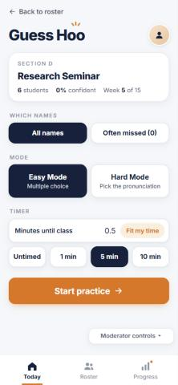
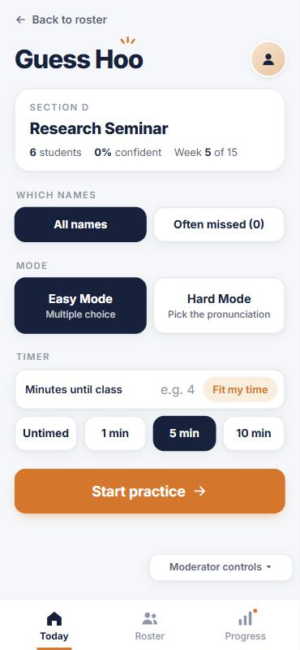
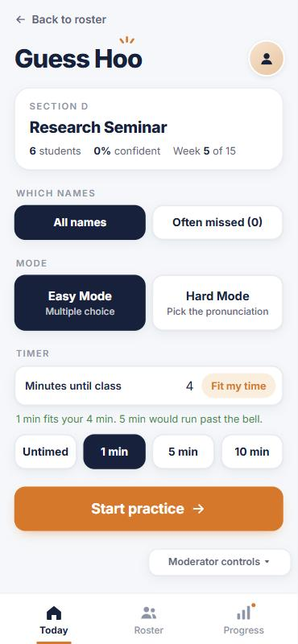
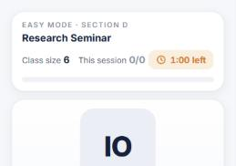
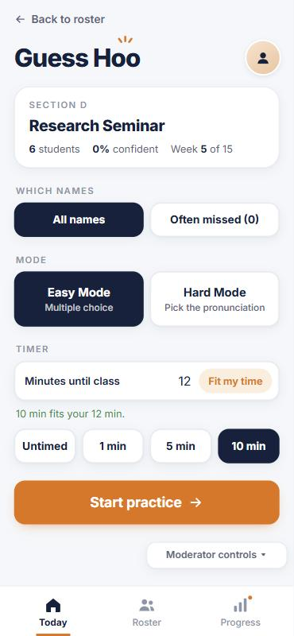
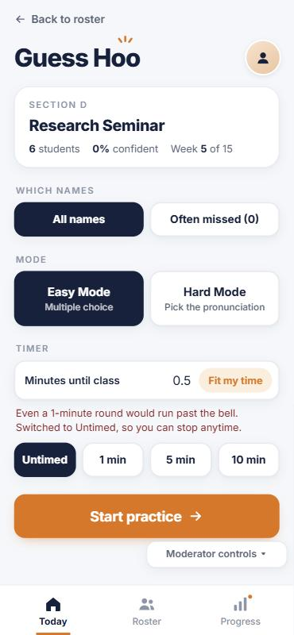
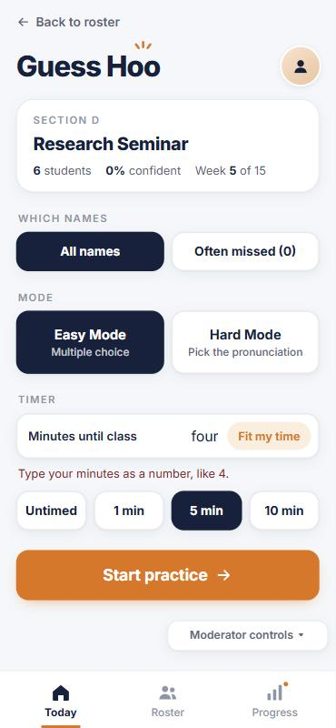

## Story

As Pascal the Professor, I want to tell the app how many minutes I have before class, so that I can get a practice round that ends before the bell without doing the math myself.

This is backlog story 2 ("Choose a duration") in `Product Brief/stories.md`. Before this change, Pascal had to choose Untimed, 1, 5 or 10 min himself. If he had 4 minutes and tapped 5 min, the round ran past the start of class.

## Scenarios

**1. Time falls between the options**
- Given the timer options are 1, 5 and 10 minutes
- And Pascal has 4 minutes before class
- When he tells the app he has 4 minutes
- Then the app chooses the 1-minute round
- And it explains that 5 minutes would run past the bell

**2. More time than the longest round**
- Given Pascal has 12 minutes before class
- When he tells the app he has 12 minutes
- Then the app chooses the 10-minute round, with no warning

**3. Not enough time for any timed round (goes wrong)**
- Given Pascal has chosen a 5-minute round
- And he has only half a minute before class
- When he tells the app he has 0.5 minutes
- Then no timed round is chosen; practice switches to Untimed so he can stop anytime
- And the app says even a 1-minute round would run past the bell

**4. Minutes that aren't a number (goes wrong)**
- Given Pascal has chosen a 5-minute round
- When he types "four" instead of a number
- Then the app asks him to type the minutes as a number
- And his 5-minute round is left as it was

## What changed

The practice setup screen has a new "Minutes until class" box with a **Fit my time** button (Enter works too). The app picks the longest timer that ends in time, shows one line saying why, and falls back to Untimed when even 1 minute won't fit. Choosing a timer by hand clears the box and the message. Only `app.js` and `style.css` changed; nothing new is saved.

## What the AI got wrong, and how I caught it

The AI made picking a timer by hand clear the "fits your time" message, but it left the old number in the box. So after Scenario 3, if I then tapped 5 min, the screen said "Minutes until class: 0.5" next to a selected 5-minute round with no warning. That is exactly the overrun this story is supposed to prevent, and the code looked fine at a glance because the message did go away.

I caught it while running Scenario 3 by hand. After seeing the Untimed warning, I tapped 5 min to set up Scenario 4 and noticed the stale "0.5" still in the box. **Fix (code, not scenario):** picking a timer by hand now clears the box as well as the message. I ran Scenario 3 again after the fix (0.5 → Untimed with the warning; then tapping 5 min leaves an empty box showing "e.g. 4"), and ran Scenario 2 after it.

| Before the fix | After the fix |
|---|---|
|  |  |

## Scenario results

All four were run by clicking and typing in the app at phone size (375 × 812) in Research Seminar (Section D), starting from Moderator controls → Reset all progress.

| # | Result | What I did | What I expected | What happened |
|---|---|---|---|---|
| 1 | **Pass** | Typed 4, tapped Fit my time, then Start practice | 1 min chosen, a note that 5 min would run past the bell, a 1-minute round | "1 min fits your 4 min. 5 min would run past the bell." 1 min highlighted. The round opened at "1:00 left". |
| 2 | **Pass** | Typed 12, tapped Fit my time | 10 min chosen, no warning | "10 min fits your 12 min." in green, 10 min highlighted. |
| 3 | **Fail, then pass after a code fix** | Picked 5 min, typed 0.5, pressed Enter, then picked 5 min by hand again | Untimed with a warning; after a hand-picked timer, no leftover minutes | The Untimed switch and the warning worked on the first run, but the "0.5" stayed in the box after tapping 5 min (see above). After the fix the box clears. |
| 4 | **Pass** | With 5 min selected, typed "four", tapped Fit my time | Asked for a number; timer unchanged | "Type your minutes as a number, like 4." in red; 5 min stayed highlighted. |

| 1. Four minutes | 1. Round starts | 2. Twelve minutes | 3. Half a minute | 4. Not a number |
|---|---|---|---|---|
|  |  |  |  |  |

Also checked: no errors in the browser console. Not checked: the voice part of the brief ("says he has four minutes"). This version uses a typed number, not speech.

## How to check it

1. Get the branch and open the app:
   ```bash
   git fetch origin
   git switch fit-my-time
   ```
   Then open `index.html` in Chrome or Edge. For phone size, press F12 and turn on the device toolbar (375 × 812).
2. Open **Moderator controls → Reset all progress**, then **Research Seminar (Section D) → Practice these names**.
3. **Scenario 1:** in **Minutes until class**, type `4` and tap **Fit my time**. You should see **1 min** selected and "5 min would run past the bell." Tap **Start practice**: the timer should show 1:00. Tap **End practice**, then **Practice these names** again.
4. **Scenario 2:** type `12` and tap **Fit my time**. You should see **10 min** selected and no warning.
5. **Scenario 3:** tap **5 min**, type `0.5`, and press Enter. You should see **Untimed** selected and the red warning. Then tap **5 min**: the box should go back to empty ("e.g. 4").
6. **Scenario 4:** with **5 min** selected, type `four` and tap **Fit my time**. You should see "Type your minutes as a number, like 4." and **5 min** should still be selected.
