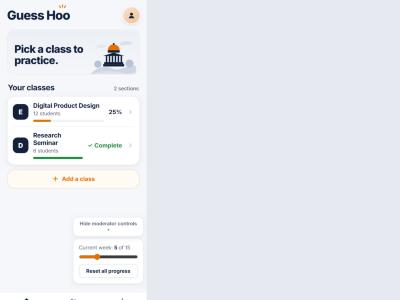
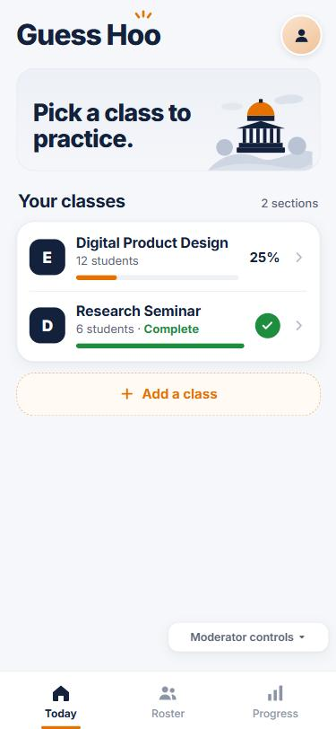
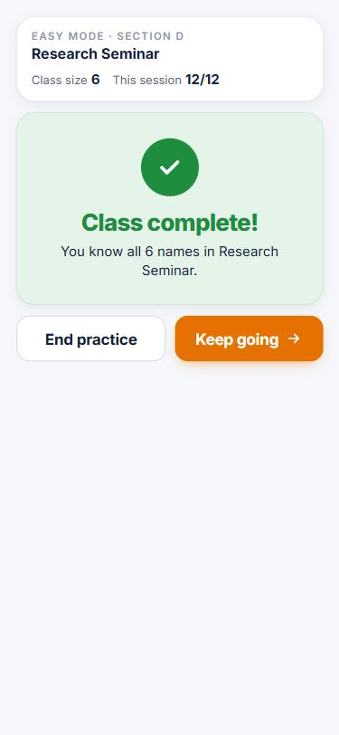
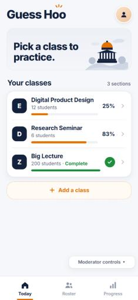

# Make "class complete" obvious on the home screen and in practice

| | |
|---|---|
| Branch | `done-more-visible` into `main` |
| Author | aidanporges-blip |
| Follows | PR #1 (Show when a class is complete) |
| Files changed | `app.js`, `style.css`, plus this write-up and its screenshots in `docs/pull-requests/` |

This is a copy of the pull request description, kept in the repo with its screenshots so it stays with the code.

## Story

As Pascal the Professor, I want an obvious "done" sign when I finish a class, both on the home screen and at the moment it happens, so that I don't miss it.

PR #1 added a "done" signal, but testing it on a phone showed it was easy to miss: in practice it was one line of feedback that disappeared on the next tap, and the home screen only ever said "100%". After finishing both classes, the home screen looked the same as any other day. That is exactly the brief's open question ("Is 100% coverage a sufficient ending?") and usability prompt 5 ("How would you know you are done?").

## Scenarios

**1. Seeing it at a glance**
- Given every student in Section D is Sure
- When Pascal looks at the home screen
- Then Section D is marked Complete with a green bar
- And Section E, which isn't finished, still shows its percentage

**2. The moment it happens**
- Given 5 of Section D's 6 students are Sure
- When Pascal answers the last one correctly
- Then a full "Class complete!" card replaces the question
- And he can end practice or keep going

**3. Not done yet (goes wrong)**
- Given a 200-student class where 199 are Sure
- When Pascal looks at the home screen
- Then the class is not marked Complete

**4. Slipping back (goes wrong)**
- Given Section D is complete
- When Pascal misses one of its students
- Then the home screen goes back to a percentage and an orange bar

## What changed

On the home screen, a finished class now shows "6 students · Complete" with a green check and a green bar instead of "100%". In practice, the answer that finishes a class replaces the face and answer buttons with one large green card ("Class complete! You know all 6 names in Research Seminar.") with End practice and Keep going underneath. Both use the same `isComplete()` check as PR #1, so a class is never marked done while anyone still needs practice.

## What the AI got wrong, and how I caught it

The AI's first version put "✓ Complete" where the percentage goes on the home screen. That label is much wider than "100%", so it squeezed the class name: at phone width "Research Seminar" wrapped onto two lines. It was caught by looking at the home screen right after finishing Section D, then confirmed at exactly 375 px wide by measuring the title (one line is 19 px tall; with the first version it was 38 px, two lines, in a 127 px wide space). Fix (code, not scenario): the right side now shows only a small green check, and the word "Complete" moved into the line under the class name ("6 students · Complete"). The title stays on one line.

Before the fix ("Research Seminar" wraps onto two lines):

## Scenario results

Run in a browser at phone size (375 × 812), starting from Moderator controls → Reset all progress. Setup answers (getting Section D to 5 of 6 Sure) were tapped through the page; each scenario step was checked on screen.

| # | Result | What I did | What I expected | What happened |
|---|---|---|---|---|
| 1 | **Fail, then pass after a code fix** | Finished Section D, went to the home screen | Section D marked Complete, green bar; Section E still a percentage | First version: marked Complete, but "Research Seminar" wrapped onto two lines. After the fix: "6 students · Complete", green check, green bar, title on one line; Section E shows 25% with an orange bar. |
| 2 | **Pass** | With 5 of 6 Sure, answered the last student (Ana Petrova) correctly | Full "Class complete!" card instead of the question | Green card "Class complete! You know all 6 names in Research Seminar.", no face or answer buttons, End practice and Keep going. Keep going went back to a normal question; End practice showed the readback. |
| 3 | **Pass** | Made a 200-student test class with 199 Sure, then all 200 | Not marked Complete at 199; Complete at 200 | 199/200: orange bar and a percentage, no Complete. 200/200: "200 students · Complete" with a green bar. |
| 4 | **Pass** | In the complete Section D, missed a student, then went home | Back to a percentage and an orange bar | "6 students 83%" with an orange bar. |

| 1. Home: Complete (after fix) | 2. The moment it happens | 3 & 4. Big class done; Section D slipped back |
|---|---|---|
|  |  |  |

Also checked: the completion card fits easily on a small phone (375 × 667) in Hard Mode with a timer (418 of 667 px used); the story 4 check (missed names come back within two questions) still passes 500/500; no console errors.

Known, not changed here: with 199 of 200 Sure, the home screen and Progress still *show* "100%" because the percentage is rounded. Nothing is marked Complete, but the number can look finished. Showing 99% until everyone is Sure would be a separate small change.

## How to check it

1. Open the preview of this branch (no git needed), or switch to the branch and open `index.html`:
   https://raw.githack.com/aidanporges-blip/NameParker/done-more-visible/index.html
   If a notice page appears, click Open the page. On a computer, press F12 and turn on the device toolbar for phone size (375 × 812).
2. Open **Moderator controls → Reset all progress**.
3. Open **Research Seminar (Section D) → Practice these names → Start practice** (Easy, Untimed). Answer by matching initials to names until only one student is left Shaky (about 11 right answers).
4. **Scenario 2:** answer that last student correctly. A large green "Class complete!" card should replace the question, with End practice and Keep going.
5. **Scenario 1:** tap End practice → Back to roster → Today. Research Seminar should read "6 students · Complete" with a green check and green bar, on one line; Digital Product Design should still show 25%.
6. **Scenario 4:** open Research Seminar, start practice, pick a wrong name, end practice and go back home. Research Seminar should show 83% with an orange bar.
