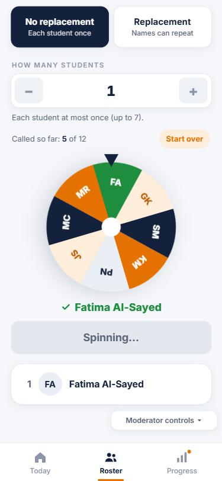

# Random cold call: spin the wheel to pick students fairly

| | |
|---|---|
| Branch | `cold-call` into `main` |
| Author | aidanporges-blip |
| Story | "IN CLASS: RANDOM COLD CALL" in `Product Brief/stories.md` |
| Files changed | `app.js`, `style.css`, `Product Brief/stories.md`, `tests/coldcall.test.js`, plus this write-up and its screenshot in `docs/pull-requests/` |

This is a copy of the pull request description, kept in the repo with its screenshot so it stays with the code.

## Story

As Pascal, during class, I want to generate a random list of students from the section I'm teaching, so I can cold call fairly and use their names without picking the same few people every time.

Where it lives: on the Today screen, after Pascal selects a class, a "Random cold call" button sits below "View progress". It opens a page where he chooses no replacement or replacement, picks how many students, and taps Spin.

OEC ratio: Professors who generate a cold-call list in a week / active professors

## Scenarios

**1. Open the cold call page from the selected class**
- Given Pascal has selected Section E on the Today screen
- When he taps "Random cold call" below "View progress"
- Then a cold call page opens for Section E
- And he can choose no replacement or replacement, and the number of students

**2. No replacement**
- Given Section E has 12 students
- And Pascal chooses no replacement and 5 students
- When he generates a list
- Then he sees 5 different students from Section E in random order

**3. Replacement**
- Given Section E has 12 students
- And Pascal chooses replacement and 5 students
- When he generates a list
- Then each of the 5 names is picked at random from all 12 students
- And the same student can appear more than once

**4. Only the selected class**
- Given Pascal has more than one class and opened the page from Section E
- When he generates a list
- Then every name on it is a Section E student

**5. Generate again**
- Given Pascal chose no replacement and has generated a list that included Jordan Smith
- When he generates again
- Then the new list has only Section E students who haven't been called yet
- And Jordan Smith is not on it

**6. Each class keeps its own list**
- Given Jordan Smith was cold called in Section E with no replacement
- When Pascal opens the cold call page for another class
- Then that class's students can all still be called
- And starting over in one class does not reset the other

**7. Everyone has been called (goes wrong)**
- Given all 12 students in Section E have been called with no replacement
- When Pascal tries to generate another list
- Then the app says everyone in this class has been called
- And he can start over to put all 12 back

**8. Asking for more students than are left (goes wrong)**
- Given Section E has 12 students and Pascal chooses no replacement
- When he tries to ask for 15 students
- Then the number can't go above the students left to call (12 at the start)
- And the app says why: with no replacement, each student can appear only once

**9. Cold calling does not change practice progress (goes wrong)**
- Given Kwabena Mensah is Shaky in Section E
- When Pascal generates a cold call list that includes Kwabena
- Then Kwabena is still Shaky
- And Section E's coverage and needs-practice list are unchanged

## What changed

The class screen has a new **Random cold call** button under View progress. It opens a page with No replacement / Replacement, a − / + number of students, and a **wheel** with one slice per student who can be picked. Tapping **Spin** spins once per name: the wheel stops with the arrow on a student, their slice turns green, their name appears, and (with no replacement) their slice pops out before the next spin. With no replacement, each class keeps its own "already called" list ("Called so far: 4 of 12", with **Start over** for that class only), so nobody is called twice until everyone has been. Nothing new is saved: the called lists last while the app is open and are cleared by a refresh or Reset all progress. Phones set to reduce motion skip the spin and show the names straight away.

## What the AI got wrong, and how I caught it

1. **"No replacement" only worked inside one list.** The first version reset the pool on every Generate, so Jordan Smith could be called in one list and again in the next. Caught while running Scenario 5 by hand: Jordan appeared in two lists in a row. That didn't match what "no replacement" should mean in class, so the behavior and the story were changed: each class now keeps its own called list until Start over, and Scenario 5 was rewritten with two new scenarios (6 and 7). This was a scenario fix and a code fix.
2. **Leaving the page mid-spin lost students.** All of a spin's names are chosen when Spin is tapped, and the first version marked them all as called right away. If Pascal left the page partway through, the names the wheel never landed on were still counted as called, so those students silently dropped out of the pool. Caught while testing the edge case of tapping Back mid-spin and checking who was marked as called. Fix (code): when the page is left mid-spin, only the names already shown count as called. Re-checked: leaving after the first landing left exactly 1 student called.
3. **The − and + signs were off-center** in their buttons (pushed to the edges). Caught on the first phone-width screenshot of the page. Fix (code): the buttons now center their sign.

## Scenario results

Scenarios 1, 4 and 5 were run by hand in the app at phone size (375 × 812), starting from Moderator controls → Reset all progress. The rest are checked by `tests/coldcall.test.js` (plus the wheel checks below). The test files were run in a browser with their code unchanged, because Node isn't installed on this computer; they should give the same results with `node tests/coldcall.test.js`.

| # | Result | How it was checked | What happened |
|---|---|---|---|
| 1 | **Pass** | By hand | Random cold call opens a page for Section E with the mode choice, the number of students, the wheel and Spin. |
| 2 | **Pass** | Test, 1,000 lists | 1000/1000 lists had 5 different Section E students; each student came first 69–97 times out of 1,000, so the order is random. |
| 3 | **Pass** | Test, 1,000 lists | 1000/1000 lists had 5 Section E names; 609 lists had a repeat; each student was picked 379–474 times out of 5,000. |
| 4 | **Pass** | By hand | With a second class imported, every name spun in Digital Product Design was from that class. |
| 5 | **Fail, then pass after a code and scenario change** | By hand, and test (200 runs) | First version: Jordan Smith came up in two lists in a row. Now: no repeats until all 12 are called (200/200 in the test); by hand, "Called so far" went up and picked slices were gone from the wheel. |
| 6 | **Pass** | Test | Calling 5 in Section E left Section D's 6 untouched; calls and Start over in D left E at 7 left. |
| 7 | **Pass** | Test | After 5 + 5 + 2, the page says "Everyone in this class has been called." and Spin is greyed out until Start over puts all 12 back. |
| 8 | **Pass** | Test | Pressing + 20 times stops at 12 with the explanation and a greyed +; 15 under Replacement drops to 12 when switching back. |
| 9 | **Pass** | Test, 500 lists | Statuses, misses, coverage and the needs-practice list unchanged; 0 writes to saved progress. |

Wheel checks (phone size): the arrow landed on the picked student every time, measured from the wheel's actual on-screen rotation (4/4 with no replacement, 3/3 with replacement); picked slices popped out (12 → 11 → 10 → 9); replacement kept all 12 slices; one student left showed a single full slice; reduce motion showed all names at once; no console errors. The story 4 test (`tests/story4.test.js`) still passes 500/500.



## How to check it

1. Switch to the branch and open the app:
   ```bash
   git fetch origin
   git switch cold-call
   ```
   Open `index.html` in Chrome or Edge, press F12, then Ctrl + Shift + M, and set 375 × 812. Or use the preview: https://raw.githack.com/aidanporges-blip/NameParker/cold-call/index.html
2. **Moderator controls → Reset all progress.**
3. **Scenario 1:** open **Digital Product Design** → **Random cold call**. The page shows No replacement / Replacement, the number of students, the wheel and **Spin**.
4. **Scenarios 2 and 5:** leave No replacement on, set 4, tap **Spin**. The wheel spins once per name and each picked slice disappears. Spin again: nobody from the first spin comes up, and "Called so far" goes up.
5. **Scenario 7:** keep spinning until everyone is called. The page says so and Spin greys out; **Start over** puts all 12 back.
6. **Scenarios 4 and 6:** add a second class (Today → Add a class), spin there, then go back to Digital Product Design. Its called list is unchanged, and every name is from the class you opened.
7. **Scenario 8:** with No replacement and nobody called yet, press + until it stops at 12 and read the note.
8. **Tests:**
   ```bash
   node tests/coldcall.test.js
   node tests/story4.test.js
   ```
